# Aurora Glass for Home Assistant

A frosted-glass dashboard card whose animations follow real entity states: dots flow along the energy lines at a speed set by the kW, the fan spins at its set speed, air streaks while the AC cools, the floor shimmers while it heats, the music bars move while a speaker plays. Hold any tile for a glass pop-up with its controls, place each widget as its own card, and give the whole of Home Assistant the same look, down to a glass top bar in place of the sidebar. Everything is set up with clicks — YAML is optional.


**Part 1 — with clicks:** [1. Install](#1-install-with-hacs) · [2. Create a dashboard](#2-create-a-dashboard) · [3. Add the card](#3-add-the-card) · [4. The visual editor](#4-the-visual-editor) · [5. Customize mode](#5-customize-mode-on-one-device) · [6. Pop-ups](#6-pop-ups) · [7. The entity card](#7-the-entity-card) · [8. Widgets as separate cards](#8-widgets-as-separate-cards) · [9. The theme](#9-the-theme-for-all-of-home-assistant) · [10. The sidebar as a top bar](#10-the-sidebar-as-a-top-bar) · [11. The complete example](#11-the-complete-example)

**Part 2 — with YAML:** [Where the YAML goes](#where-the-yaml-goes) · [The smallest card](#the-smallest-working-card) · [The parts of the card](#the-parts-of-the-card) · [Widget sizes](#widget-sizes) · [Energy flow](#energy-flow) · [Lights and scenes](#lights-and-scenes) · [The other widgets](#the-other-widgets) · [Pop-ups and the entity card](#pop-ups-and-the-entity-card-in-yaml) · [Widget cards](#widget-cards-in-yaml) · [All card options](#all-card-options) · [When something doesn't work](#when-something-doesnt-work)

---

# Part 1 — Set up with clicks

## 1. Install with HACS

1. HACS → ⋮ → **Custom repositories** → paste `https://github.com/comixdx/ha-aurora-glass` (1), type **Dashboard** (2) → **Add** (3).

   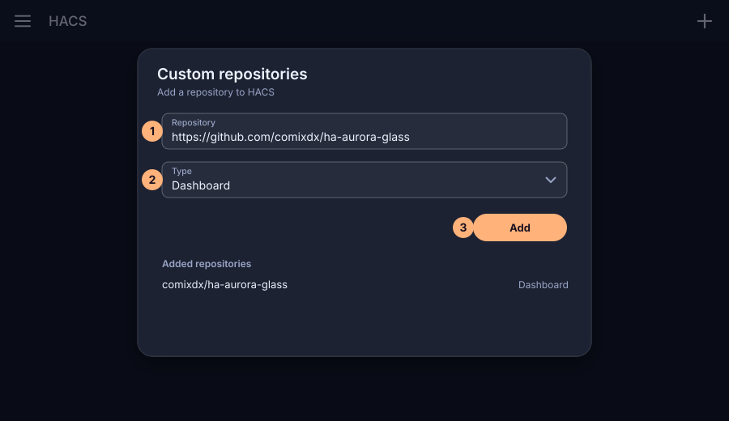

2. Open **Aurora Glass** in HACS → **Download** (1). HACS registers the card for you.

   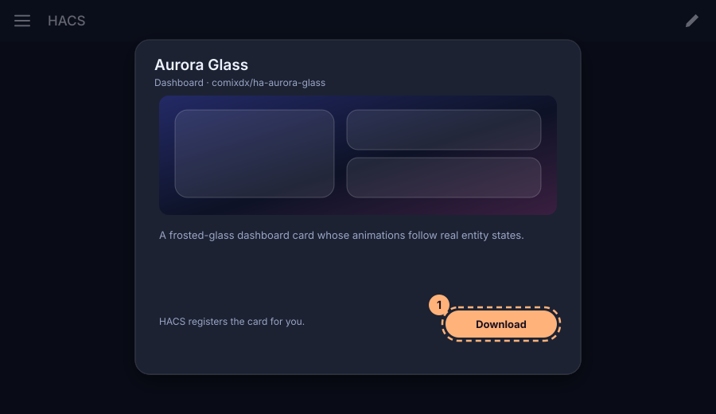

3. Reload the browser (on the phone app: Settings → Companion app → Troubleshooting → **Reset frontend cache**, or restart the app).

Updates show up in HACS the same way; after updating, reload the browser once more.

## 2. Create a dashboard

1. Settings → **Dashboards** → **Add dashboard** → **New dashboard from scratch** (1). Name it, pick an icon (2) → **Create** (3), then open it.

   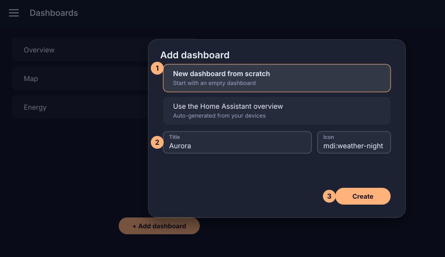

2. ✏️ (top right, 1) → if asked, choose **Start with an empty dashboard** (2).

   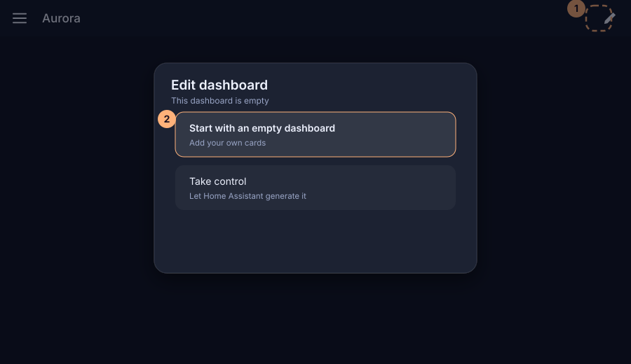

3. Pick the view type: click the ✏️ next to the view tab (1) → **View type** (2) → **Save** (3).
   - **Panel (single card)** for one big Aurora Glass board that fills the screen;
   - **Sections** (the default) to place each widget as its own card — see [step 8](#8-widgets-as-separate-cards).

   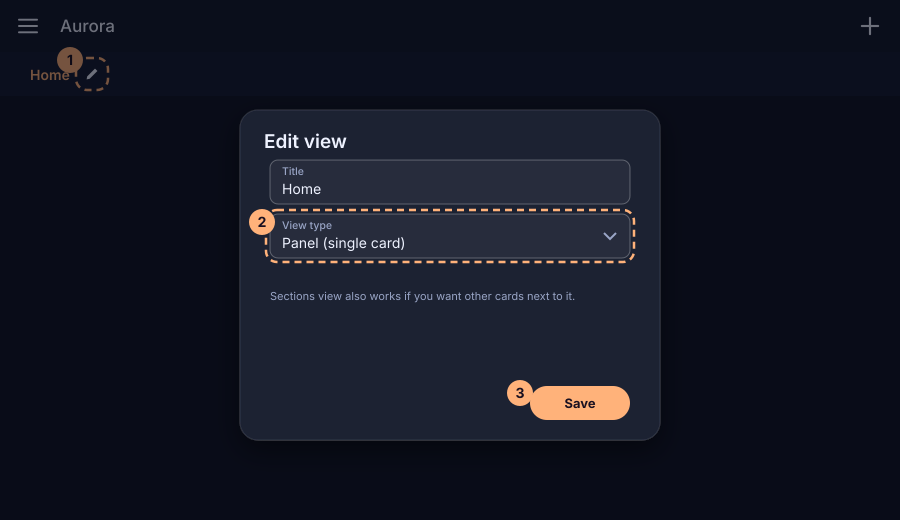

## 3. Add the card

1. **+ Add card** → search **Aurora** (1) → select **Aurora Glass** (2).

   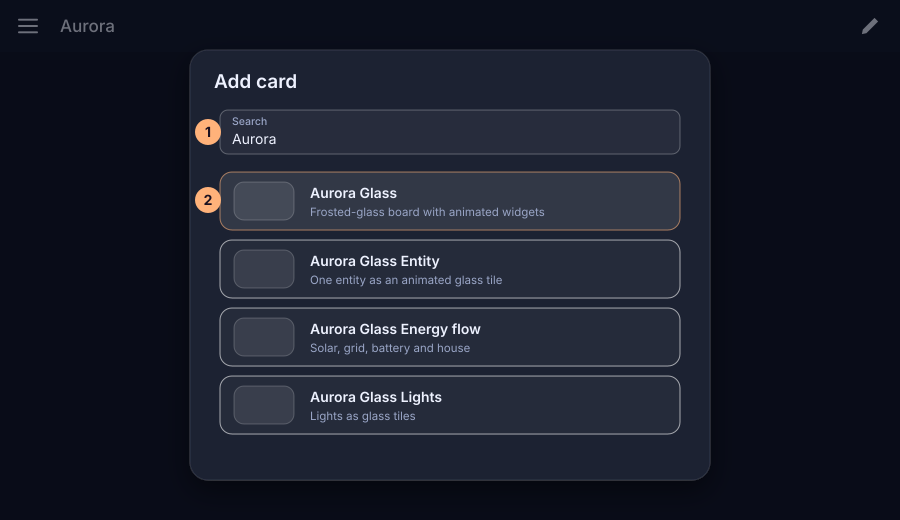

2. It opens already filled in with what it finds in your Home Assistant: solar, battery, grid and house power, lights, climate, scenes, media, fans, lock, door and window sensors, weather.
3. Adjust anything in the editor (next step) → **Save** → **Done**.

That's it — the dashboard looks like the picture at the top of this page. The glass look is applied to the whole dashboard by the card itself, so no theme file is needed.

## 4. The visual editor

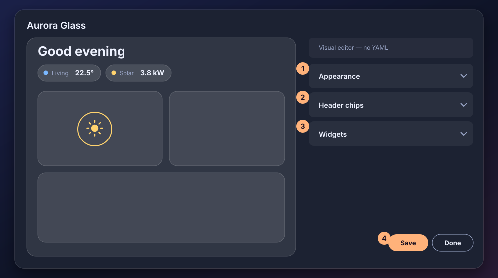

- **Appearance** — theme preset (Auto follows HA's light/dark, or Midnight, Dawn, Lagoon, Ember), accent colour, glass blur, switches for animations, the drifting background, the header, the Customize button and *Apply the glass theme to the whole dashboard*; title, language (Auto / English / Română) and minimum height (`100vh` fills the screen in a Panel view).

  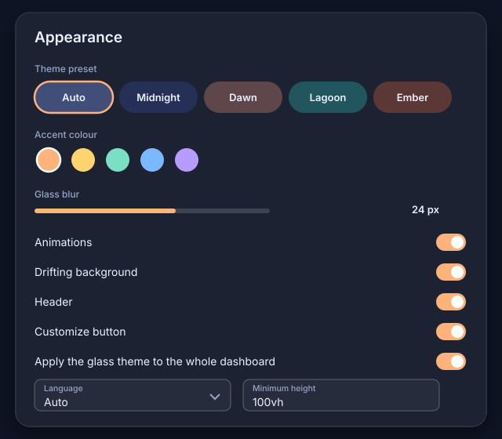

- **Header chips** — sensors shown in the header, each with a name and a dot colour; **Add chip** (1) adds one.

  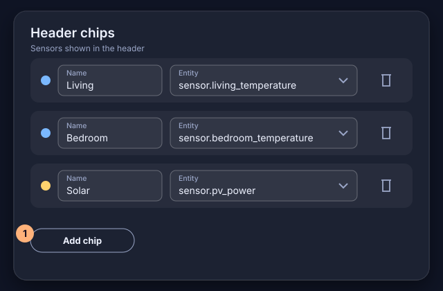

- **Widgets** — one row per widget, opened with a click:
  - ↑ ↓ to reorder and 🗑 to delete (1–3), **Add widget** at the bottom (4);
  - type (energy flow, lights, climate, scenes, now playing, fan, floor heating, security, weather) and size S / M / L / XL;
  - Home Assistant's own entity pickers for every sensor and device;
  - lights and scenes get their own rows with name, subtitle or description;
  - energy flow shows solar, grid, battery, the inverter in the middle and the load; pick the inverter's power, status (e.g. GoodWe work mode) and temperature sensors to show them on the inverter node, and use the two switches for inverters (such as GoodWe) whose battery sensor is positive when discharging or whose grid sensor is positive when exporting.

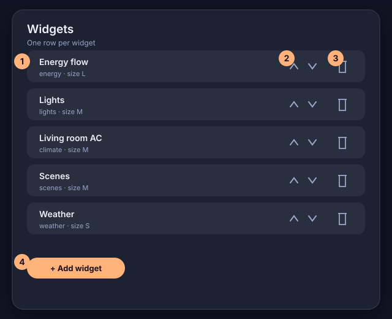

An opened widget: type (1), size (2), Home Assistant's entity pickers (3) and, for energy flow, the two switches for inverters that count the other way (4).

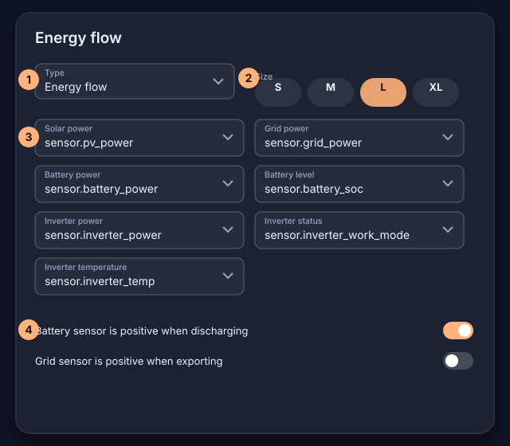

## 5. Customize mode (on one device)

The **Customize** button on the dashboard changes the layout on that one device: move, resize or park widgets, switch preset and accent, blur and animations. A wall tablet and your phone can look different this way. *Reset layout* returns to the editor's layout, and any setting you later change in the editor replaces the device's choice.

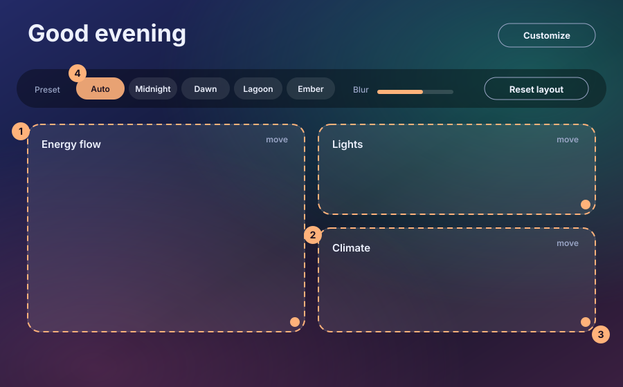

`prefers-reduced-motion` on a device always turns the animations off.

## 6. Pop-ups

Hold any tile (or right-click it), or tap a header chip, an energy-flow node or a widget's icon, and a glass pop-up grows out of it. On a phone it slides up from the bottom and closes with a swipe down.

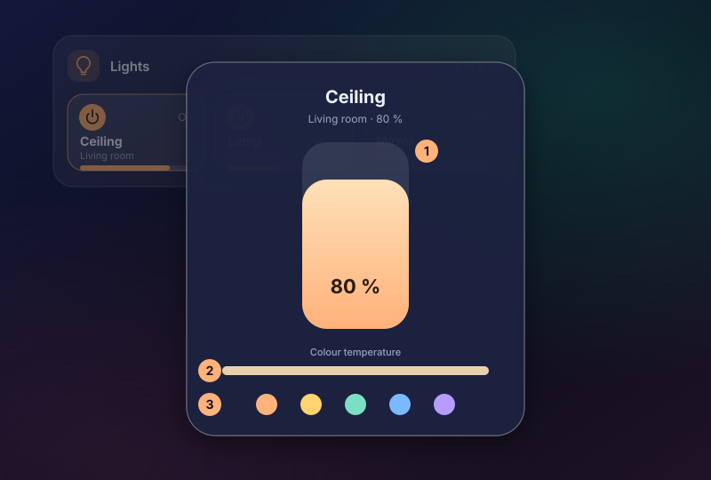

| Entity | In the pop-up |
|---|---|
| Light | Drag-to-dim brightness slab, on/off, colour temperature, colour swatches, effects |
| Switch, input boolean | A big on/off slab |
| Fan | Speed slab, spinning fan, oscillate, direction, preset modes |
| Climate | Large dial with − / +, hvac modes, fan modes, presets, air or heat animation |
| Media player | Artwork, progress, previous / play / next, volume, mute, sources |
| Cover | Moving shutter, position slab, open / stop / close |
| Lock | Animated lock, lock / unlock / open |
| Sensor | Big value, 24-hour chart that draws itself, min / average / max |
| Binary sensor, person | Animated icon and a 24-hour on/off timeline |
| Weather | Animated sky, humidity / wind / pressure, 5-day forecast |
| Scene, script, button | A run button with a ripple |


**⋯** or *More details* opens Home Assistant's own dialog. In the editor, *Hold a tile … to open* lets you choose the Aurora Glass pop-up, Home Assistant's dialog or nothing. Home Assistant's own dialogs get the glass look too: automatically on dashboards with the Aurora Glass card, and everywhere when you use [the theme](#9-the-theme-for-all-of-home-assistant).

**Weather service.** In the weather widget pick *Weather service*: a Home Assistant weather entity from any integration, or **Open-Meteo**, built into the card — no integration, account or API key, it uses your home location and also gives the pop-up a 5-day forecast.

## 7. The entity card

**+ Add card → Aurora Glass Entity** puts a single entity anywhere as a glass tile (or a row with a switch) whose icon animates with its state: the bulb glows and sends out rays at its brightness, the power ring turns, fan blades spin at their speed, the snowflake turns while cooling and the flame flickers while heating, the speaker bars bounce, the lock shackle jumps, blinds slide, doors swing, motion sends out ripples, the thermometer and battery fill to their level, and power sensors flicker while energy flows. Tap toggles (or runs a scene), hold opens the pop-up; both can be changed in its editor along with layout, icon, theme and accent.


## 8. Widgets as separate cards

Every widget is also a card of its own, for a **Sections** view where Home Assistant places and sizes each card.

1. In a Sections view: **+ Add card** → search **Aurora Glass** → pick **Energy flow**, **Lights**, **Climate**, **Scenes**, **Now playing**, **Fan**, **Floor heating**, **Security**, **Weather** or **Header** (greeting, date, chips and the round header buttons).
2. It opens filled in with matching entities. The editor has the same fields as that widget in the big card, plus **Size** and an **Appearance** section (theme preset, accent, blur, animations, pop-up and language). The Header card also edits the chips and the header buttons (icon, name, admins only, tap action).
3. **Save**, then drag the cards where you want them and resize them by their corner.

Each one is a card of its own:

| | |
|---|---|
| 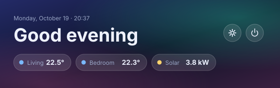 | 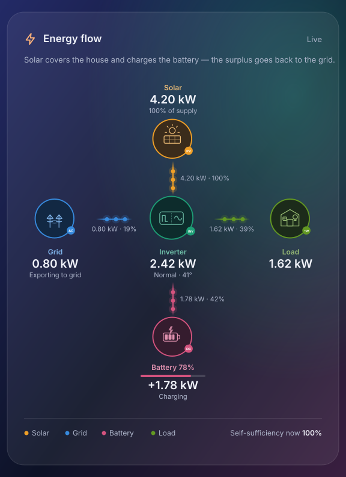 |
| 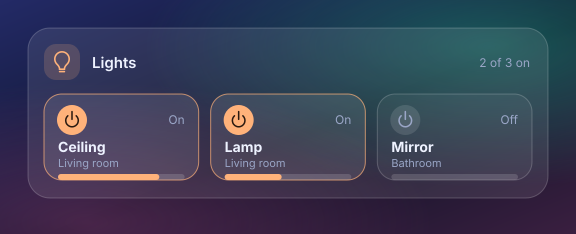 |  |
| 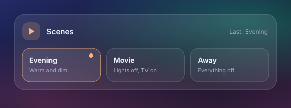 |  |
|  |  |
|  | 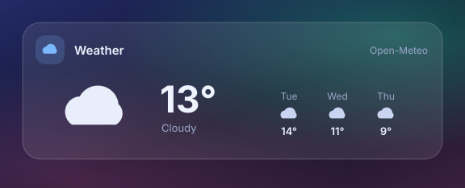 |

They look and animate exactly like the widgets on the board, pop-ups included. The Customize button belongs to the big card only.

## 9. The theme for all of Home Assistant

`themes/aurora_glass.yaml` puts the same look on every dashboard and on the rest of the interface: the sidebar (or [top bar](#10-the-sidebar-as-a-top-bar)), settings pages and dialogs. It has four themes: **Aurora Glass** (Midnight in dark mode, Dawn in light mode), **Aurora Glass Lagoon** and **Aurora Glass Ember**.

1. Copy the file to `/config/themes/`.
2. Make sure `configuration.yaml` has:
   ```yaml
   frontend:
     themes: !include_dir_merge_named themes
   ```
3. Developer tools → Actions → `frontend.reload_themes` → **Perform action**.
4. Your profile (1) → **Theme** → **Aurora Glass** (2). Leave **Mode** on **Auto** (3) to get Midnight in dark mode and Dawn in light mode.

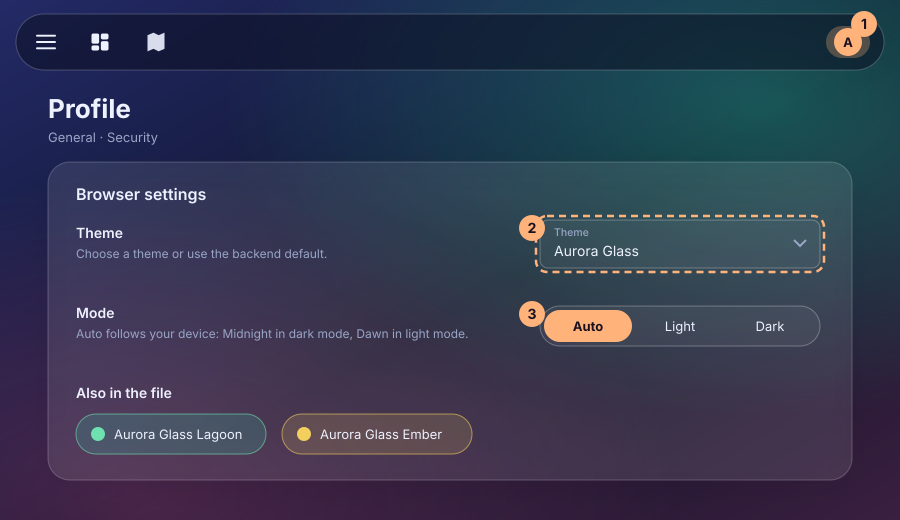

Not needed for the Aurora Glass dashboard itself.

## 10. The sidebar as a top bar

[`extras/ha-top-sidebar.js`](extras/ha-top-sidebar.js) moves Home Assistant's own sidebar to the top of the screen, as a floating glass bar over the dashboard background: the menu button, your dashboards and panels in a row, and Settings, notifications and your profile at the end. It works on phones and in the companion app too. "Hide sidebar" in your profile and Home Assistant's kiosk mode still hide it. It takes its colours from the active theme, so it matches best with [the theme](#9-the-theme-for-all-of-home-assistant).

1. Copy the file to `/config/www/ha-top-sidebar.js` (with the File editor or Samba add-on).
2. Add it to `configuration.yaml`:
   ```yaml
   frontend:
     extra_module_url:
       - /local/ha-top-sidebar.js?v=1
   ```
3. Settings → System → ⏻ → **Restart Home Assistant**.
4. Reload the browser (on the phone app: Settings → Companion app → Troubleshooting → **Reset frontend cache**).

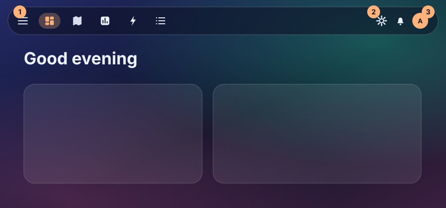

The menu button (1) switches between icons only and icons with labels. On a phone the bar looks the same, and pages that don't fit scroll sideways.

Browsers keep `/local/` files for a month, so after replacing the file raise `?v=` and restart. The file restyles Home Assistant's own interface, so a frontend update can change what it needs; it is made for Home Assistant 2026.10. To remove it, delete the line from `configuration.yaml` and restart.

## 11. The complete example

[`examples/dashboard.yaml`](examples/dashboard.yaml) is a whole dashboard: the Aurora Glass card with every widget, kiosk mode (guests get it full screen without the sidebar and top bar) and a small round power button next to the Customize button (`header_buttons`) that opens a glass menu with Restart, Reboot host and Shut down (with confirmation), visible only to the users you list. Kiosk mode needs kiosk-mode; the power menu needs Bubble Card.

1. Create an empty dashboard ([step 2](#2-create-a-dashboard)).
2. ✏️ → ⋮ → **Raw configuration editor** → paste the file → **Save**.
3. Replace the entity ids with yours and `YOUR_ADMIN_USER_ID` with your user id (Settings → People → Users → open the user; the id is in the address bar).


---

# Part 2 — Configuring with YAML

Everything here can also be done in the visual editor. YAML is handy when you want to copy a setup between dashboards, keep it in a backup, or type faster than you click. Both write the same config, so you can switch back and forth at any time.

## Where the YAML goes

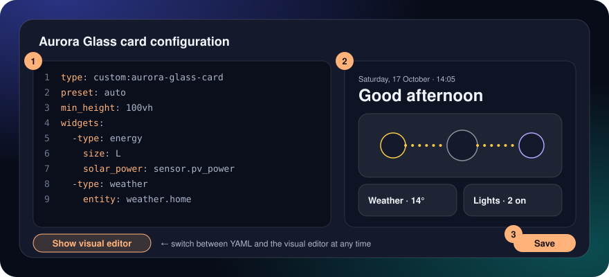

1. Edit the dashboard → click the Aurora Glass card (or **+ Add card** → **Aurora Glass**) → **Show code editor**. The YAML of this one card appears.
2. The preview updates as you type. If something is wrong, the card shows a red line naming the problem.
3. **Save**.

To see the whole dashboard instead (all views and cards), use ⋮ → **Raw configuration editor** while editing the dashboard. The Aurora Glass card is the block that starts with `type: custom:aurora-glass-card`.

## The smallest working card

```yaml
type: custom:aurora-glass-card
widgets:
  - type: weather
    source: open_meteo
```


Two rules matter more than anything else:

- `type: custom:aurora-glass-card` — with `custom:` in front.
- `widgets:` is a list. Each widget starts with `- type:` and everything that belongs to it is indented under it by **two spaces**. YAML uses spaces, never tabs.

## The parts of the card

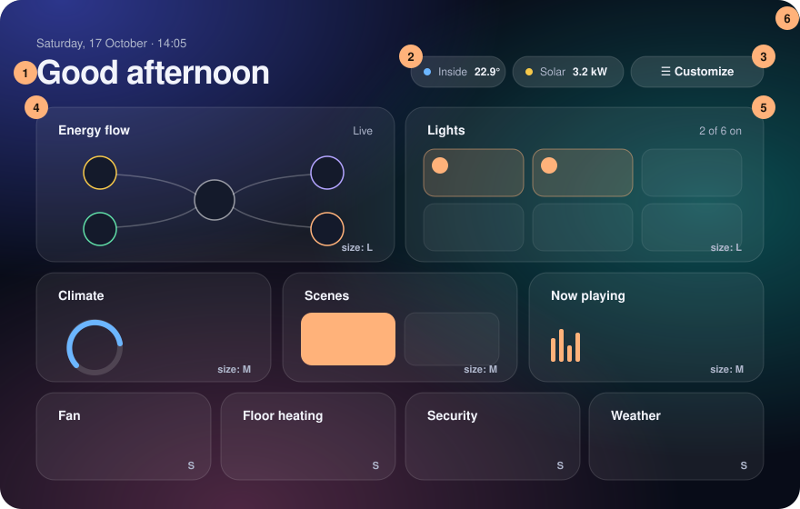

| # | What | YAML |
|---|---|---|
| 1 | Greeting and date | `title: Acasă` replaces the greeting; `header: false` hides the whole header |
| 2 | Header chips | `chips:` — a list of sensors |
| 3 | Customize button | `customize: false` hides it |
| 4 | A widget | one item under `widgets:` |
| 5 | Widget size | `size: S`, `M`, `L` or `XL` |
| 6 | Look of the whole card | `preset`, `accent`, `blur`, `motion`, `background`, `dashboard_theme` |


```yaml
type: custom:aurora-glass-card
preset: auto            # auto | midnight | dawn | lagoon | ember
accent: peach           # peach | gold | mint | sky | lilac
blur: 24                # glass blur in px, 0–40
motion: true            # animations
background: true        # the card's own drifting background
dashboard_theme: true   # give every card on this dashboard the glass look
min_height: 100vh       # fill the screen in a Panel view
language: ro            # optional; default is your profile language
title: Acasă            # optional; default is the greeting
chips:                  # (2)
  - entity: sensor.living_room_temperature
    name: Inside
    color: cool         # hex or cool | heat | solar | battery | grid | alert
  - entity: sensor.pv_power
    name: Solar
    color: solar
header_buttons:         # small round buttons next to Customize
  - icon: mdi:logout
    name: Log out
    tap_action:
      action: navigate
      navigation_path: /profile
widgets:
  - type: weather
    entity: weather.home
```

## Widget sizes

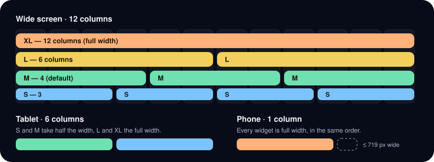

On a wide screen the card has 12 columns: `S` takes 3, `M` 4 (the default), `L` 6 and `XL` all 12. On a tablet there are 6 columns, and on a phone every widget is full width in the same order. Widgets fill gaps automatically, so `L L` / `M M M` / `S S S S` rows line up neatly.

## Energy flow

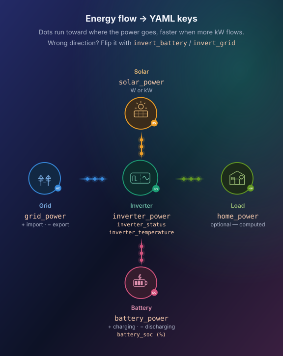

```yaml
  - type: energy
    size: L
    solar_power: sensor.pv_power                  # W or kW
    grid_power: sensor.active_power
    battery_power: sensor.battery_power
    battery_soc: sensor.battery_state_of_charge    # %
    home_power: sensor.house_consumption           # optional
    inverter_power: sensor.inverter_output_power   # optional
    inverter_status: sensor.work_mode              # optional, any text sensor
    inverter_temperature: sensor.inverter_temperature  # optional
    invert_battery: true    # GoodWe: battery_power is + when discharging
    invert_grid: true       # GoodWe: active_power is + when exporting
```


The entity ids above are examples. Use the ones from **Settings → Devices & services → your inverter**, or start typing in the visual editor's entity picker.

**Which way the dots run.** The card expects the battery to be positive while charging and the grid positive while importing. If a line flows the wrong way on your dashboard, set `invert_battery: true` or `invert_grid: true`. Most GoodWe setups need both.

**Missing sensors are fine.** Without `grid_power` the grid node disappears; without `battery_power` and `battery_soc` the battery node disappears. Without `home_power` the load is calculated as solar + grid import − battery charging. Without `inverter_power` the inverter shows solar minus battery charging.

## Lights and scenes

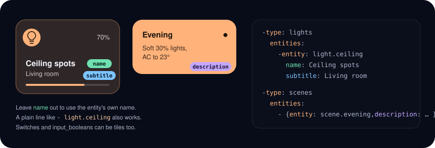

```yaml
  - type: lights
    size: L
    entities:
      - entity: light.living_room_ceiling
        name: Ceiling spots       # optional, default = the entity's name
        subtitle: Living room     # optional
      - light.kitchen_worktop     # short form, entity id only
      - entity: switch.bathroom_light   # switches and input_booleans work too
        name: Bathroom
  - type: scenes
    entities:
      - entity: scene.good_morning
        description: Lights at 80%, bedroom stays dark
      - entity: script.night       # scripts and buttons work too
        name: Night
        description: Hallway dim, bedroom AC only
```


Tap a tile to toggle it. The slider under the light tiles dims the last light you tapped. Hold a tile for its pop-up.

## The other widgets

```yaml
  - type: climate
    entity: climate.living_room_ac
    title: Living room
    modes: [cool, heat, dry, off]    # optional, up to 4 buttons

  - type: media
    entity: media_player.living_room
    subtitle: Living room

  - type: fan
    size: S
    entity: fan.bedroom              # tap cycles 33 / 66 / 100 % / off

  - type: floor
    size: S
    entity: climate.bathroom_floor   # or a switch / input_boolean
    temperature: sensor.bathroom_floor_temperature
    subtitle: Bathroom

  - type: security
    size: S
    lock: lock.front_door
    lock_name: Front door
    sensors:
      - binary_sensor.kitchen_window
      - binary_sensor.bedroom_window

  - type: weather
    size: S
    entity: weather.home             # any weather integration

  - type: weather                    # or the built-in Open-Meteo service
    size: S
    source: open_meteo               # free, no account or API key
    latitude: 44.43                  # optional, default = your home
    longitude: 26.10
    location_name: Bucharest         # optional
```

| | |
|---|---|
|  |  |
|  |  |
|  |  |

Every widget also accepts `title:` (replaces the heading) and `id:` (only needed if you use the same widget type twice and want each to keep its own place in Customize mode).

## Pop-ups and the entity card in YAML

Holding a tile opens a glass pop-up with the entity's controls. To change that for the whole card:

```yaml
type: custom:aurora-glass-card
popup: aurora      # aurora (default) | native = Home Assistant's dialog | none
widgets:
  - …
```

To put one entity anywhere on a dashboard as an animated glass tile, use the entity card:

```yaml
type: custom:aurora-glass-entity
entity: light.living_room_ceiling
name: Ceiling            # optional
icon: mdi:ceiling-light  # optional, replaces the animated icon
layout: tile             # tile | row (with an on/off switch on the right)
tap_action: auto         # auto | toggle | popup | native | none
hold_action: popup       # popup | native | none
subtitle: Living room    # optional, default = the area
preset: auto             # auto | midnight | dawn | lagoon | ember
accent: peach            # peach | gold | mint | sky | lilac
glass: true              # false = no glass background
show_state: true
motion: true
```


`auto` toggles lights, switches, fans and covers, runs scenes, scripts and buttons, and opens the pop-up for everything else. In a Sections view, a tile takes 3 columns × 2 rows and a row takes 6 × 1; drag the corner to resize.

## Widget cards in YAML

`custom:aurora-glass-<type>` takes the widget's keys from the sections above, plus `size` and the card options `preset`, `accent`, `blur`, `motion`, `popup`, `dashboard_theme` and `language`. `custom:aurora-glass-header` takes `title`, `chips` and `header_buttons`.

```yaml
type: custom:aurora-glass-climate
entity: climate.living_room_ac
title: Living room
modes: [cool, heat, off]
```


```yaml
type: custom:aurora-glass-header
chips:
  - entity: sensor.living_room_temperature
    name: Inside
    color: cool
header_buttons:
  - icon: mdi:power
    name: Power
    admin_only: true
    tap_action:
      action: navigate
      navigation_path: "#power"
```

## All card options

| Key | Default | |
|---|---|---|
| `widgets` | — | List of widgets. Order = default layout. |
| `preset` | `auto` | `auto`, `midnight`, `dawn`, `lagoon`, `ember`. |
| `accent` | `peach` | `peach`, `gold`, `mint`, `sky`, `lilac`. |
| `blur` | `24` | Glass blur in px. |
| `motion` | `true` | Animations. |
| `background` | `true` | The card's own drifting background. |
| `dashboard_theme` | `true` | Apply the glass look to every card on this dashboard. |
| `min_height` | — | e.g. `100vh` in a Panel view. |
| `chips` | — | `{entity, name, color, decimals}`; `color` is a hex or `cool`/`heat`/`solar`/`battery`/`grid`/`alert`. |
| `title` | greeting | Header title. `header: false` hides the header. |
| `customize` | `true` | `false` hides the Customize button. |
| `header_buttons` | — | Small round buttons next to the Customize button: `{icon, name, tap_action}` (any Home Assistant action: navigate, perform-action with confirmation, …), shown to everyone or only to `admin_only: true` / `users: [user ids]`. |
| `popup` | `aurora` | What holding a tile opens: `aurora` (glass pop-up), `native` (Home Assistant's dialog) or `none`. |
| `language` | profile | `en`, `ro`. Add others with `translations: { de: { lights: "Licht" } }`. |
| `id` | page path | Key for the saved device layout, if the card is on several dashboards. |

Every widget takes `type`, `size` (`S`/`M`/`L`/`XL`), `title`, `id`, and:

| type | Keys |
|---|---|
| `energy` | Five nodes with the inverter in the middle: solar, grid and battery connect to the inverter, the inverter feeds the load. `solar_power`, `grid_power`, `battery_power`, `battery_soc`, `home_power` (load, optional), `inverter_power`, `inverter_status`, `inverter_temperature` (all three optional), `invert_battery`, `invert_grid`. W or kW. Battery + = charging, grid + = import, unless inverted. |
| `lights` | `entities`: lights, switches or input_booleans, as an entity id or `{entity, name, subtitle}`. Tap toggles; the slider dims the last tapped light. |
| `climate` | `entity`, `modes` (up to 4, e.g. `[cool, heat, dry, off]`). +/− taps are bundled into one command. |
| `scenes` | `entities`: `scene.*`, `script.*`, `button.*` or `{entity, name, description}`. The most recently run scene is marked active (`active_hours`, default 12). |
| `media` | `entity`, `subtitle`. |
| `fan` | `entity`. Tap cycles 33 / 66 / 100 % / off. |
| `floor` | `entity` (climate, switch or input_boolean), `temperature`, `subtitle`. |
| `security` | `lock`, `lock_name`, `sensors` (binary sensors; open ones pulse). |
| `weather` | `entity` (any weather integration: Met.no, OpenWeatherMap, AccuWeather, …), **or** `source: open_meteo` for the built-in Open-Meteo service (free, no account), with optional `latitude`, `longitude` (default: your home) and `location_name`. |

## When something doesn't work

| What you see | Usually means |
|---|---|
| `Custom element doesn't exist: aurora-glass-card` | The card isn't loaded. Install it with HACS and reload the page; check there is only one Aurora Glass entry in Settings → Dashboards → Resources. |
| `Entity not found: light.xxx` on a tile | That entity id doesn't exist. Copy the exact id from Settings → Entities. |
| `add a widgets: list` | `widgets:` is missing or not indented as a list (`- type: …`). |
| `widget 3 needs a type` | The third item under `widgets:` has no `type:`, often because of wrong indentation. |
| The energy dots run the wrong way | Set `invert_battery` or `invert_grid` ([energy flow](#energy-flow)). |
| Changes in the editor don't show on one device | That device has its own Customize layout; open Customize → **Reset layout**. |
| The whole YAML turns red | Usually a tab character or a missing space after `:`. Use two spaces per level. |
| The sidebar is still on the left | `extras/ha-top-sidebar.js` isn't loaded: check the `extra_module_url` line, restart, and reset the browser or app cache. |
